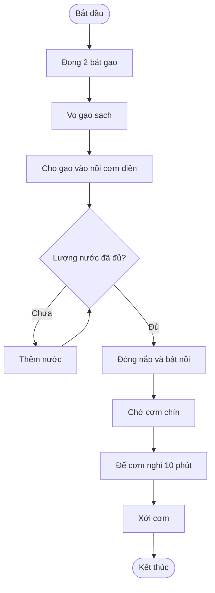

# Sơ đồ quy trình nấu cơm

## Mô phỏng

1. Đong 2 bát gạo và vo sạch.
2. Cho gạo vào nồi, kiểm tra lượng nước.
3. Nếu nước chưa đủ, thêm nước rồi kiểm tra lại.
4. Đóng nắp, bật nồi và chờ cơm chín.
5. Để cơm nghỉ 10 phút rồi xới cơm.

Trong mô phỏng Python, mức nước ban đầu là `1.2`, thấp hơn mức cần `1.5`, nên cần thêm nước trước khi nấu.