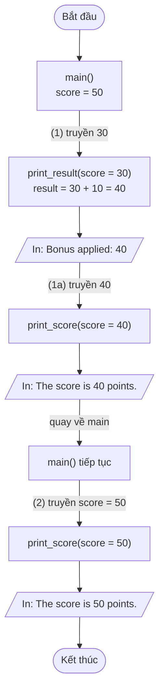
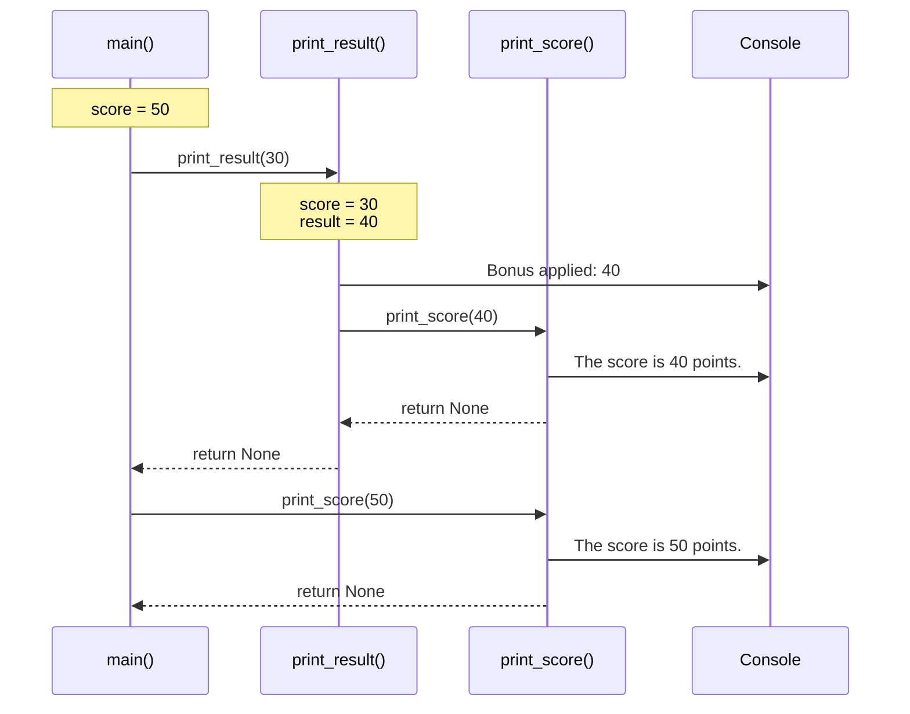

# Sơ đồ chương trình t1-15.py

## Code

```python
def print_score(score: int):
    print(f'The score is {score} points.')


def print_result(score: int):
    result = score + 10
    print(f'Bonus applied: {result}')
    print_score(result)


def main():
    score = 50
    print_result(30)
    print_score(score)


main()
```

## 1. Luồng gọi hàm (Flowchart)



## 2. Trình tự gọi và trả về (Sequence diagram)



## 3. Call stack theo từng bước

| Bước | Dòng | Stack (đỉnh ở trên)                              | Output                    |
|------|------|--------------------------------------------------|---------------------------|
| 1    | 12   | `main`                                           |                           |
| 2    | 6–7  | `print_result(30)` → `main`                      | `Bonus applied: 40`       |
| 3    | 2    | `print_score(40)` → `print_result(30)` → `main`  | `The score is 40 points.` |
| 4    | 14   | `main`                                           |                           |
| 5    | 2    | `print_score(50)` → `main`                       | `The score is 50 points.` |
| 6    | —    | *(rỗng)*                                         |                           |

## Kết quả

```
Bonus applied: 40
The score is 40 points.
The score is 50 points.
```

> **Lưu ý:** cả ba hàm đều có biến tên `score`, nhưng đó là ba biến **cục bộ** riêng biệt.
> `score = 50` trong `main` **không** được truyền vào `print_result`, vì dòng 13 truyền thẳng giá trị `30`.
